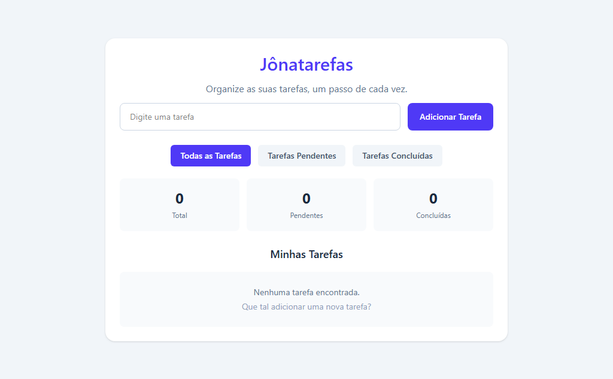

# 📝 Jônatarefas

**Organize as suas tarefas, um passo de cada vez.**

- O **Jônatarefas** é uma aplicação de gerenciamento de tarefas desenvolvida com React, TypeScript e Tailwind CSS.

- O projeto permite adicionar, concluir, excluir e filtrar tarefas, além de armazenar os dados no navegador para que permaneçam disponíveis mesmo após atualizar ou fechar a página.

- O objetivo do projeto é praticar conceitos fundamentais do desenvolvimento Front End, como componentização, gerenciamento de estado, tipagem com TypeScript e criação de interfaces responsivas.

## 📸 Captura de Tela



## 🚀 Funcionalidades

- **Adicionar tarefas:** Cria novas tarefas de maneira simples e rápida.
- **Armazenamento local:** Os dados são salvos no LocalStorage do navegador.
- **Concluir tarefas:** Marque as tarefas como concluídas ou volte a deixá-las pendentes.
- **Excluir tarefas:** Remova tarefas com confirmação antes da exclusão.
- **Filtrar tarefas:** Visualize todas as tarefas, somente as pendentes ou somente as concluídas.
- **Interface responsiva:** Layout adaptável para diferentes tamanhos de tela.
- **Resumo de tarefas:** Acompanhe a quantidade total, pendente e concluída.

## 🛠️ Tecnologias Utilizadas

<p align="left">
    
    
    
    
</p>

- **LocalStorage:** Armazenamento das tarefas no navegador.
- **Lucide React:** Biblioteca de ícones.
- **React:** Construção da interface e componentização.
- **Tailwind CSS:** Estilização e criação de uma interface responsiva.
- **TypeScript:** Tipagem estática e maior segurança no desenvolvimento.

## 📂 Estrutura do Projeto

```text
src/
├── components/
|
│   ├── Cabecalho/
│   ├── Formulario/
│   ├── Filtro/
│   ├── Resumo/
│   ├── Lista/
│   └── Cartao/
│
├── types/
│   └── Tarefa.ts
│
├── App.tsx
├── main.tsx
└── index.css
```

## 💻 Como Executar o Projeto

**1. Clone o repositório:**

```bash
git clone https://github.com/jonatasoliveiradasilva/jonatarefas
```

**2. Acesse a pasta do projeto:**

```bash
cd jonatarefas
```

**3. Instale as dependências:**

```bash
npm install
```

**4. Execute a aplicação:**

```bash
npm run dev
```

**5. Acesse no Navegador:**

Abra o endereço local apresentado pelo terminal.

## 📚 Aprendizados

Durante o desenvolvimento deste projeto, estou colocando em prática conceitos importantes para minha evolução como Desenvolvedor Front End Jr:

- Criação e organização de componentes reutilizáveis.
- Estilização e responsividade com Tailwind CSS.
- Gerenciamento de estados com useState.
- Manipulação de arrays com map e filter.
- Persistência de dados utilizando LocalStorage.
- Tipagem de propriedades e interfaces com TypeScript.
- Utilização de props para comunicação entre componentes.
- Utilização do useEffect para sincronização de dados.

## 🔮 Melhorias Futuras

- Adicionar categorias às tarefas.
- Editar tarefas existentes.
- Implementar datas de vencimento.
- Melhorar a experiência visual da aplicação.

### O **Jônatarefas** faz parte da minha jornada de aprendizado e desenvolvimento de projetos práticos para o meu portfólio.

### ⭐ **Se você gostou do projeto, deixe uma estrela no repositório!**
